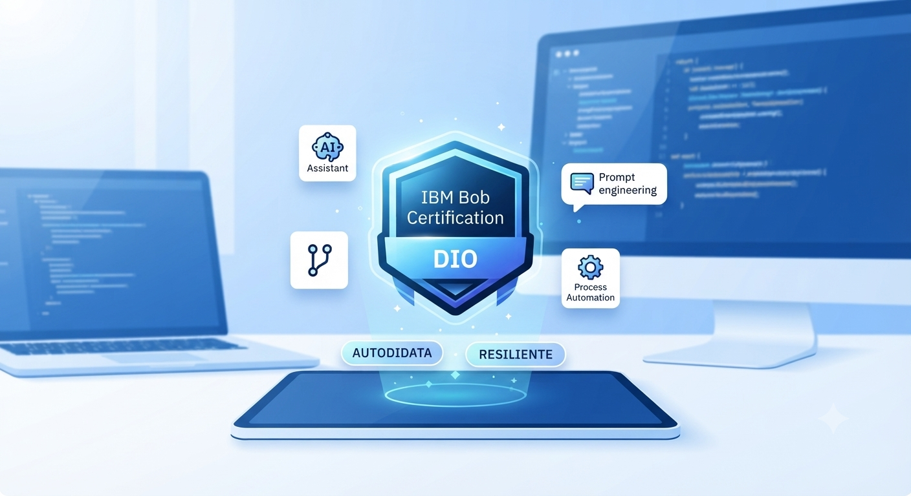

  

  
  
  
  
  
  
  
  
  
  

# Bootcamp IBM Bob: IA de Nível Empresarial para Desenvolvedores e Tech Leaders

> **AI Engineer | Especialista em Governança 4.0 e Qualidade | Engenheiro Químico**  
> [Mauá, SP](mailto:ornelas.tozato@gmail.com) | [LinkedIn](https://www.linkedin.com/in/rafaeltozato81) | [GitHub](https://github.com/Rafael-TOZATO) | [Portfólio PWA](https://tozato-dev-hub.vercel.app) | [Medium](https://medium.com/@ornelas.tozato)

Repositório estruturado para consolidar a jornada completa de capacitação, módulos teóricos, práticas de desenvolvimento e projetos executados no programa patrocinado pela **IBM** em parceria com a **DIO**, com foco em versionamento profissional e agentes de IA.

## 📌 Sobre o Projeto

Este repositório documenta a aplicação prática de engenharia de software assistida por inteligência artificial, integrando o ecossistema de agentes IBM Bob ao fluxo de desenvolvimento corporativo. O escopo abrange desde os fundamentos operacionais de agentes de IA até a implementação de protocolos avançados de contexto, automação de git e padrões de governança em produção.

## 🛠️ Stack Tecnológica e Habilidades

- **Inteligência Artificial:** AI Agents, IBM Bob, Model Context Protocol (MCP)
- **Engenharia de Prompt e Contexto:** Custom Modes, Rules de comportamento e otimização com arquivos de exclusão (`.bobignore`)
- **Versionamento e Fluxo de Trabalho:** Git avançado, operações via Terminal e gerenciamento de Pull Requests
- **Operações e Governança:** Segurança em produção, métricas de eficiência e boas práticas corporativas

## 🏆 Trilha de Certificações Concluídas

| Módulo / Curso | Carga Horária | Data | Código de Validação |
| :--- | :---: | :---: | :---: |
| Agentes de IA e IBM Bob: Fundamentos para Desenvolvedores | 4h | 22/08/2026 | FTVYVMLT |
| IBM Bob: Conhecendo Seu Parceiro de Código | 1h | 22/08/2026 | ZAOCSNZH |
| Os Modos do IBM Bob na Prática | 1h | 22/08/2026 | YEPJCRJU |
| Bob no Fluxo Git: do Terminal ao Pull Request | 1h | 22/08/2026 | 4SW9FYIT |
| IBM Bob no Dia a Dia: Modos, Contexto e Fluxo Git | 4h | 22/08/2026 | W9NHXNFL |
| MCP: Dando Superpoderes ao Seu Agente de IA | 1h | 23/08/2026 | BPMLAVRV |
| Bob do Seu Jeito: Custom Modes, Rules e .bobignore | 1h | 25/08/2026 | 8USMD4UW |
| IBM Bob Avançado: MCP, Custom Modes e Personalização | 2h | 25/08/2026 | UQ8LNJKU |
| Bob em Produção: Segurança, Boas Práticas e Métricas | 1h | 28/08/2026 | M9ZD8CVP |
| **Diploma Principal - Bootcamp IBM Bob** | **15h** | **06/09/2026** | **D7XQ6OYM** |

## ⚙️ Desenvolvimento Autodidata e Resolução de Problemas (Troubleshooting)

Durante a execução prática da trilha e a estruturação do ambiente de desenvolvimento com agentes de IA, foram aplicadas abordagens estruturadas para superar desafios operacionais:

1. **Gerenciamento de Contexto de Repositório:** Ajustes finos na definição de escopo para evitar ruídos informacionais gerados por arquivos desnecessários no escopo do agente, mitigados através de regras específicas e diretivas de exclusão (`.bobignore`).
2. **Validação e Integração de Fluxos MCP:** Investigação e resolução de dependências em protocolos de contexto para garantir a comunicação fluida entre ferramentas locais e modelos de IA corporativos.
3. **Automação de Git e Pull Requests:** Resolução de conflitos de versionamento e padronização de commits gerados por assistência de IA, assegurando a integridade e rastreabilidade do histórico do repositório.

## 🛡️ Governança 4.0 — Segurança e Qualidade

Este repositório adota controles automatizados de Governança 4.0 para assegurar a integridade dos artefatos e do código, rastreabilidade das alterações, gestão de dependências e prevenção de exposição de credenciais.

* **Automação de Qualidade e Segurança:** Análises automatizadas e portas de verificação (*status checks*) ativas em segundo plano.
* **Fluxo Sem Atrito:** Dispensa de aprovações manuais redundantes com *auto-merge* habilitado para agilizar entregas.
* **Integridade de Código:** Proteção de branch e bloqueio de *force pushes* para garantir a estabilidade da base principal.

---

## 📬 CONTATOS E PERFIS

💻 **PROJETOS E PORTFÓLIOS**
* Ecossistema de Aplicativos: [tozato-ai-core.vercel.app](https://tozato-ai-core.vercel.app)
* H-Folio Professional: [h-folio-I0.vercel.app](https://h-folio-I0.vercel.app)

🐙 **CÓDIGOS E REPOSITÓRIOS**
* GitHub: [github.com/Rafael-TOZATO](https://github.com/Rafael-TOZATO)

✍️ **ARTIGOS E PUBLICAÇÕES**
* Medium: [medium.com/@ornelas.tozato](https://medium.com/@ornelas.tozato)
* Comunidade DEV: [dev.to/rafaeltozato](https://dev.to/rafaeltozato)

💼 **CONTATO**
* LinkedIn: [linkedin.com/in/rafaeltozato81](https://www.linkedin.com/in/rafaeltozato81)
* E-mail: ornelas.tozato@gmail.com
